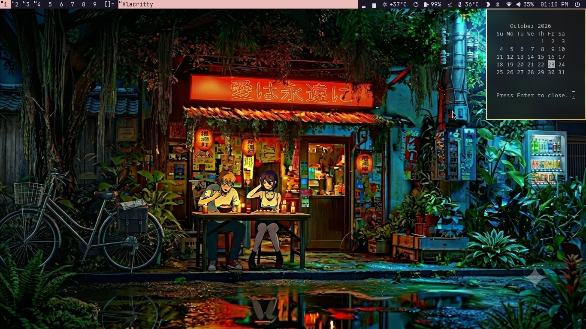
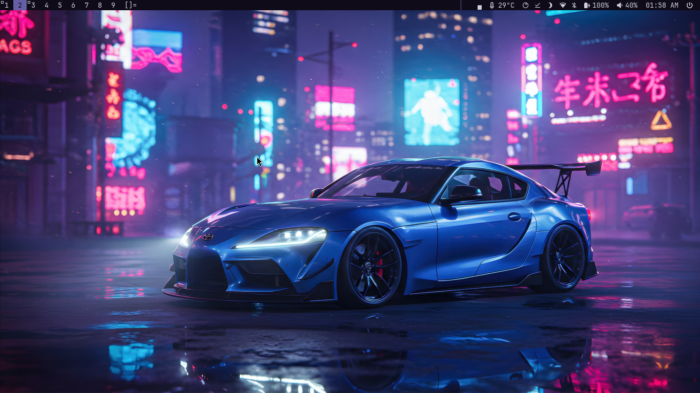
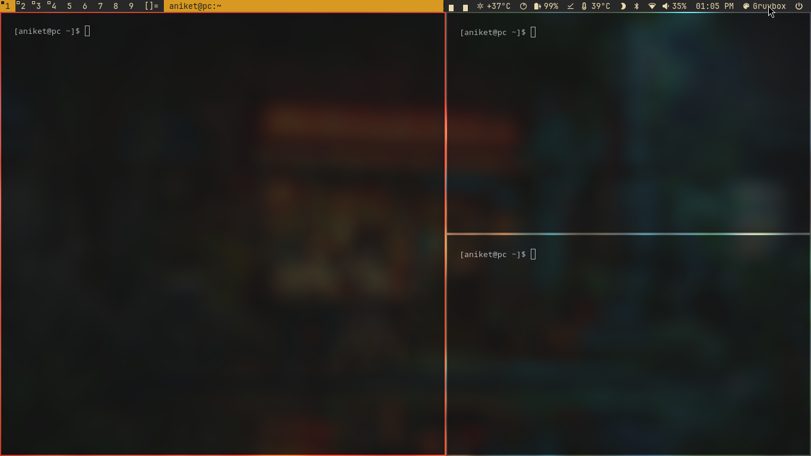
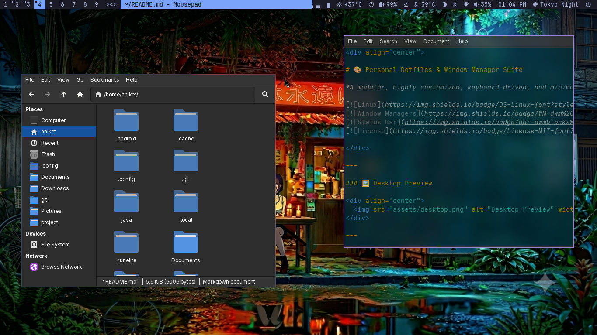
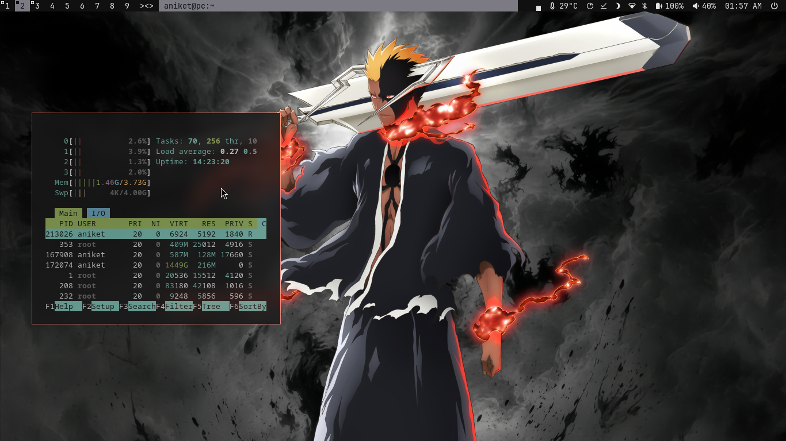

<div align="center">
*Clean, modular, and performance-focused dotfiles for Linux.*
[](LICENSE)
[](https://archlinux.org)
[](https://www.gnu.org/software/bash/)

## 🎨 Overview

A minimal, keyboard-driven desktop environment built around **dwm** and **dmenu**. It features system-wide, dynamic theme switching powered by **Pywal**, fully synchronized across the window manager, launcher, terminal, and status bar.
<br />


</div>
## ✨ Features

* **Pywal Theme Engine:** Dynamic color palette synchronization across `dwm`, `dmenu`, `alacritty`, and system components.

* **Interactive Status Bar (`dwmblocks`):** Highly modular status bar applets with full mouse interaction powered by the `statuscmd` patch:

  * **Icon Click:** Toggle individual status modules on and off on the fly.

  * **Left Click:** Launch specific application settings or GUI tools (e.g., sound mixer, network manager).

  * **Middle Click:** Instantly open the block's underlying shell script inside `neovim` for quick editing.

* **State Preservation:** Retains window layouts, active tags, and client states across live restarts (`SIGHUP`).

* **Lightweight & Modular:** Minimal background footprint, fast response times, and clean configuration separation.

## 📦 Software & Dependencies

This setup utilizes lightweight, minimal daily tools. Install all core dependencies on Arch Linux with:

### Core Applications & Tools

* **Terminal:** `alacritty`

* **File Manager:** `thunar`

* **Text Editor:** `neovim`

* **Launcher:** `rofi` & `dmenu`

* **Compositor:** `picom`

* **Wallpaper Manager:** `feh`

* **Theme Engine:** `pywal`

### System & Build Dependencies

```
sudo pacman -S --needed base-devel libx11 libxft libxinerama xorg-xinit xorg-server \
                       alacritty thunar neovim rofi picom feh python-pywal \
                       dunst xdotool

```

## 🛠️ dwm Patch List

To replicate this environment from a clean `dwm` build, apply the following patches:

* [`statuscmd`](https://dwm.suckless.org/patches/statuscmd/) — Enables clickable blocks and mouse interaction for `dwmblocks`.

* [`pertag`](https://dwm.suckless.org/patches/pertag/) — Keeps individual layouts and zoom settings per tag.

* [`xresources`](https://dwm.suckless.org/patches/xresources/) — Loads theme colors dynamically from Xresources (`xrdb`) for Pywal support.

* [`preserveonrestart`](https://dwm.suckless.org/patches/preserveonrestart/) — Preserves window layout and tag assignments during live restarts (`SIGHUP`).

* [`systray`](https://dwm.suckless.org/patches/systray/) — Native system tray for system tray applets.

## ⌨️ Keybindings Quick Reference

| Key Combination | Action | 
| ----- | ----- | 
| `Super` + `Enter` | Launch Terminal (`Alacritty`) | 
| `Super` + `R` | Launch Application Menu (`Rofi`) | 
| `Super` + `W` | Open Pywal Wallpaper & Theme Switcher (`Dmenu`) | 
| `Super` + `E` | Open File Manager (`Thunar`) | 
| `Super` + `C` | Close Active Window | 
| `ALT` + `NUM` | Change Tags| 
| `ALT` + `Shift` + `NUM` | Move Tags | 
| `ALT` + `Shift` + `Q` | Exit / Restart Session | 

## 🚀 Installation & Setup

### 1. Clone the Repository

Clone the configuration into your `~/.config` folder:

```
git clone https://github.com/cyaniket999/dotconfig.git ~/.config

```

### 2. Link Home Configuration Files

Create the necessary symlinks for home-level configurations:

```
ln -s ~/.config/.xinitrc ~/.xinitrc
chmod +x ~/.xinitrc

ln -s ~/.config/.Xresources ~/.Xresources 'Optional if u dont want to use pywal'
chmod +x ~/.Xresources 
```

### 3. Compile Suckless Utilities

Navigate to each suckless build directory and install them:

```
# Build dwm
cd ~/.config/dwm && sudo make clean install

# Build dwmblocks
cd ~/.config/dwmblocks && sudo make clean install

# Build dmenu
cd ~/.config/dmenu && sudo make clean install

```

## 🏗️ Building from Scratch (Upstream Suckless)

If you prefer building this environment manually from clean upstream sources:

1. **Clone official repositories:**

   ```
   git clone https://git.suckless.org/dwm
   git clone https://git.suckless.org/dmenu
   git clone https://github.com/UtkarshVerma/dwmblocks-async.git
   
   ```

2. **Apply Patches:**
   Download the corresponding `.diff` files from [dwm.suckless.org/patches](https://dwm.suckless.org/patches/) and apply them:

   ```
   cd dwm
   patch -p1 < path/to/patch.diff
   
   ```

3. **Configure & Build:**
   Customize `config.h` to define your terminal, keybindings, and custom scripts, then recompile:

   ```
   sudo make clean install
   
   ```
## 📸 Screenshots






<div align="center">
Crafted for **Linux**
</div>